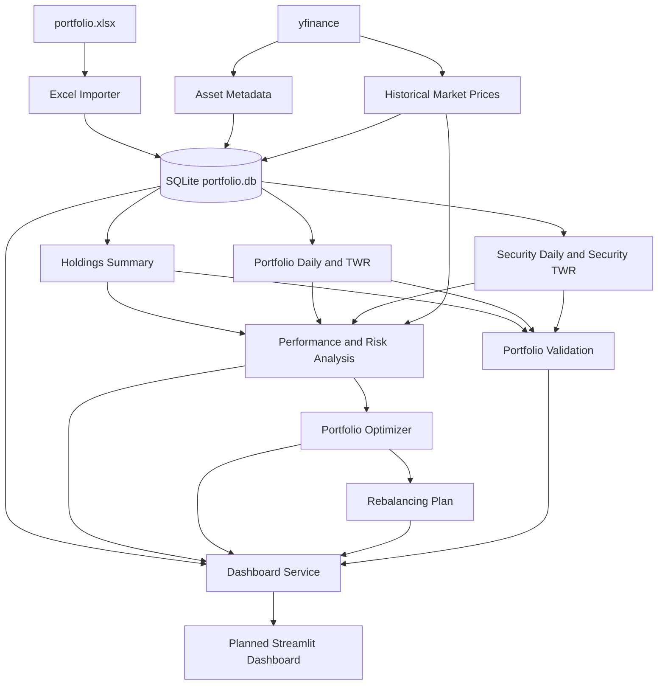

# US Equity Portfolio Decision Support System

Bu proje, ABD borsalarında işlem gören ve ABD dolarıyla fiyatlanan varlıklardan oluşan bir yatırım portföyünü analiz etmek için geliştirilen Python tabanlı bir karar destek sistemidir.

Sistem; kullanıcının Excel dosyasındaki gerçek işlemleri okuyarak portföyü yeniden oluşturur, geçmiş fiyatları indirir, güncel pozisyonları ve nakit bakiyesini hesaplar, günlük portföy değerini çıkarır, TWR performansını ve risk ölçülerini hesaplar, portföy optimizasyonu yapar ve seçilen hedef portföye göre yeniden dengeleme önerileri üretir.

> **Önemli:** Bu uygulama yatırım tavsiyesi vermez. Hesaplamalar yalnızca karar desteği ve eğitim amacı taşır. Optimizasyon ve yeniden dengeleme sonuçları otomatik alım-satım emri değildir.

## İçindekiler

1. [Projenin amacı ve kapsamı](#projenin-amacı-ve-kapsamı)
2. [Mevcut geliştirme durumu](#mevcut-geliştirme-durumu)
3. [Sistemin genel çalışma akışı](#sistemin-genel-çalışma-akışı)
4. [Proje klasör yapısı](#proje-klasör-yapısı)
5. [Gerekli yazılımlar](#gerekli-yazılımlar)
6. [Projeyi sıfırdan kurma](#projeyi-sıfırdan-kurma)
7. [portfolio.xlsx nasıl hazırlanır?](#portfolioxlsx-nasıl-hazırlanır)
8. [Veritabanı yapısı](#veritabanı-yapısı)
9. [Pipeline nasıl çalıştırılır?](#pipeline-nasıl-çalıştırılır)
10. [Yeni verilerle portföyü güncelleme](#yeni-verilerle-portföyü-güncelleme)
11. [Dosyaların ve önemli fonksiyonların açıklaması](#dosyaların-ve-önemli-fonksiyonların-açıklaması)
12. [Hesaplama mantığı](#hesaplama-mantığı)
13. [Analiz dosyalarını ayrı ayrı çalıştırma](#analiz-dosyalarını-ayrı-ayrı-çalıştırma)
14. [Git ve GitHub kullanımı](#git-ve-github-kullanımı)
15. [Sık karşılaşılan hatalar](#sık-karşılaşılan-hatalar)
16. [Planlanan Streamlit arayüzü](#planlanan-streamlit-arayüzü)
17. [Sınırlamalar](#sınırlamalar)

---

## Projenin amacı ve kapsamı

Projenin temel amacı, bireysel yatırımcının portföyündeki işlemleri tek bir sistem içinde birleştirerek aşağıdaki sorulara cevap vermektir:

- Güncel portföy değeri kaç USD?
- Portföyde ne kadar nakit var?
- Her hisseden veya ETF'den kaç adet bulunuyor?
- Pozisyonların maliyeti, güncel değeri ve kâr/zararı nedir?
- Portföy zaman içinde nasıl performans gösterdi?
- Portföyün TWR getirisi nedir?
- Portföyün volatilitesi, Sharpe oranı ve maksimum düşüşü nedir?
- Varlıklar birbirleriyle ne kadar ilişkili?
- Mevcut portföy minimum varyans veya maksimum Sharpe portföyüne göre nasıl konumlanıyor?
- Seçilen hedef dağılıma geçmek için hangi varlıktan ne kadar alınmalı veya satılmalı?

### Desteklenen yatırım araçları

Uygulama şu anda yalnızca:

- ABD borsalarında işlem gören hisse senetlerini,
- ABD borsalarında işlem gören ETF'leri,
- ABD borsalarında işlem gören ADR'ları,
- USD nakit bakiyesini

desteklemek üzere tasarlanmıştır.

Tüm portföy değerleri, fiyatlar, nakit hareketleri ve sonuçlar USD cinsindedir. Döviz dönüşümü yapılmaz.

### Kapsam dışında olanlar

- BIST veya başka ülke borsalarında yerel para birimiyle işlem gören varlıklar
- Doğrudan kripto para işlemleri
- Döviz dönüşümü ve kur riski modeli
- Otomatik emir gönderimi
- Monte Carlo simülasyonu
- Vergi hesaplama sistemi
- Garantili getiri veya yatırım tavsiyesi

---

## Mevcut geliştirme durumu

Projenin backend kısmında şu özellikler çalışmaktadır:

- SQLite veritabanı kurulumu ve şema kontrolü
- Excel'den trade, nakit hareketi ve temettü aktarımı
- Otomatik işlem ID üretimi
- İşlem doğrulama ve tarih/saat normalizasyonu
- Otomatik hisse bölünmesi düzeltmesi
- `net_flow_usd` ve `cumulative_shares` hesaplaması
- yfinance üzerinden şirket bilgisi ve geçmiş fiyat indirme
- Açık ve kapalı pozisyon fiyat geçmişi
- Delist olmuş TWTR için trade-price fallback
- Güncel holdings özeti ve USD nakit hesabı
- Günlük portföy tablosu ve portföy TWR hesabı
- Günlük ticker geçmişi ve hisse bazlı TWR hesabı
- Risk analizi
- Minimum variance ve maximum Sharpe optimizasyonu
- Efficient frontier
- Seçili hisselerle optimizasyon
- Hedef ağırlıklara göre rebalancing planı
- Trade, nakit hareketi ve temettü ekleme/düzenleme/silme servisleri
- Hatalı veri değişikliklerinde database snapshot ve otomatik geri alma
- Dashboard için hazır veri servisleri
- 11 yapısal ve finansal kontrolden oluşan portföy doğrulama servisi
- Tüm temel veri hazırlama adımlarını tek komutta çalıştıran sekiz aşamalı pipeline
- Excel importu, işlem servisleri ve backend entegrasyonları için otomatik testler

Streamlit kullanıcı arayüzü henüz oluşturulmamıştır. Mevcut kodlar uygulamanın hesaplama ve veri katmanını oluşturmaktadır.

---

## Sistemin genel çalışma akışı



Kullanıcı yalnızca ham işlemlerini Excel'e girer. Hesaplanan alanlar Python tarafından oluşturulur ve SQLite veritabanına kaydedilir.

---

## Proje klasör yapısı

```text
Project Folder/
├── .venv/                         # Yerel Python sanal ortamı; GitHub'a yüklenmez
├── backend/
│   ├── database.py                # Ortak SQLite bağlantı ve doğrulama araçları
│   ├── database_setup.py          # Veritabanı tablolarını ve indeksleri kurar
│   ├── excel_importer.py          # Excel'i okur, doğrular ve ham verileri kaydeder
│   ├── asset_metadata.py          # Ticker metadata bilgilerini indirir
│   ├── market_data.py             # Tarihsel piyasa fiyatlarını indirir
│   ├── portfolio_calculator.py    # Holdings özeti ve nakit bakiyesi
│   ├── portfolio_daily_calculator.py # Günlük portföy ve TWR
│   ├── security_daily_calculator.py  # Günlük ticker geçmişi ve hisse TWR'ı
│   ├── performance_calculator.py  # Hisse bazlı performans ölçüleri
│   ├── risk_calculator.py         # Risk ölçüleri ve risk katkısı
│   ├── portfolio_optimizer.py     # Efficient frontier ve optimizasyon
│   ├── rebalancing_calculator.py  # Al/sat/tut öneri tablosu
│   ├── portfolio_validation_service.py # Yapısal ve finansal tutarlılık kontrolleri
│   ├── portfolio_refresh_service.py # Veri değişikliğinden sonra güvenli yenileme
│   ├── transaction_service.py     # Trade, nakit ve temettü CRUD işlemleri
│   ├── dashboard_service.py       # Frontend'in kullanacağı hazır veri fonksiyonları
│   └── portfolio_pipeline.py      # Sekiz veri hazırlama adımını sırayla çalıştırır
├── tests/
│   ├── conftest.py                # İzole test database'i ve ortak test araçları
│   ├── test_transaction_service.py # İşlem servisi testleri
│   ├── test_backend_integration.py # Backend entegrasyon testleri
│   └── test_excel_importer.py     # Excel import ve doğrulama testleri
├── pytest.ini                     # Pytest klasör ve Python path ayarları
├── .gitignore                     # Kişisel ve geçici dosyaları Git dışında tutar
├── portfolio.xlsx                 # Kullanıcının tam işlem geçmişi
├── portfolio.db                   # Üretilen SQLite veritabanı; GitHub'a yüklenmez
├── requirements.txt               # Python bağımlılıkları
├── control.py                     # Geliştirme sırasında kullanılan kontrol dosyası
└── README.md                      # Bu doküman
```

`__pycache__` klasörleri Python tarafından otomatik oluşturulur. Bunların kullanıcı tarafından düzenlenmesi veya GitHub'a yüklenmesi gerekmez.

---

## Gerekli yazılımlar

Projeyi çalıştırmak için şunlar gerekir:

- Python
- Terminal veya komut satırı
- İnternet bağlantısı
- Excel dosyalarını açabilecek bir uygulama
- İsteğe bağlı olarak Visual Studio Code
- GitHub kullanılacaksa Git

Projenin mevcut geliştirme ortamı Python 3.14 kullanmaktadır. Farklı bir Python sürümünde çalışılacaksa paket uyumluluğu ayrıca kontrol edilmelidir.

### Kullanılan Python paketleri

`requirements.txt` içinde şu paketler bulunmaktadır:

- `pandas`: tablo ve zaman serisi işlemleri
- `numpy`: sayısal hesaplamalar
- `openpyxl`: Excel okuma
- `yfinance`: Yahoo Finance verileri
- `scipy`: portföy optimizasyonu
- `matplotlib`, `seaborn`, `plotly`: grafikler ve görselleştirme

Streamlit arayüzü eklendiğinde `streamlit` de `requirements.txt` dosyasına eklenecektir.

---

## Projeyi sıfırdan kurma

### 1. Proje klasörüne girin

Terminali açın ve proje klasörüne geçin:

```bash
cd "Project Folder"
```

Klasörün tam yolunu kullanmanız gerekiyorsa boşluk içeren yolu çift tırnak içine alın.

### 2. Sanal ortam oluşturun

Sanal ortam, bu projede kullanılan paketleri diğer Python projelerinden ayırır.

macOS veya Linux:

```bash
python3 -m venv .venv
source .venv/bin/activate
```

Windows PowerShell:

```powershell
py -m venv .venv
.venv\Scripts\Activate.ps1
```

Terminal satırının başında `(.venv)` görünüyorsa sanal ortam aktiftir.

### 3. Paketleri yükleyin

```bash
python -m pip install --upgrade pip
python -m pip install -r requirements.txt
```

Kurulumu kontrol etmek için:

```bash
python -m pip show pandas
```

### 4. Excel dosyasını hazırlayın

Proje ana klasöründe `portfolio.xlsx` bulunmalıdır. Dosyanın yapısı sonraki bölümde ayrıntılı olarak açıklanmıştır.

### 5. Tam pipeline'ı çalıştırın

```bash
python backend/portfolio_pipeline.py portfolio.xlsx --replace-existing
```

Bu komut veritabanını hazırlar, Excel'i içeri aktarır, piyasa verilerini indirir ve temel portföy tablolarını oluşturur.

---

## portfolio.xlsx nasıl hazırlanır?

Excel dosyası tam işlem geçmişini içermelidir. Dosyada tam olarak şu üç sheet bulunmalıdır:

1. `trades`
2. `cash_movements`
3. `dividends`

Sheet isimleri küçük harfle ve burada yazıldığı şekilde kullanılmalıdır.

### Genel Excel kuralları

- Birinci satır sütun isimlerini içermelidir.
- Her işlem ayrı bir satır olmalıdır.
- Sayısal değerler yuvarlanmamalıdır; mümkün olan en ham değer kullanılmalıdır.
- ID sütunları eklenmemelidir. ID değerleri SQLite tarafından otomatik oluşturulur.
- `net_flow_usd` ve `cumulative_shares` Excel'e eklenmemelidir. Bunları Python hesaplar.
- Tarihler tercihen `YYYY-MM-DD` biçiminde yazılmalıdır.
- Saat alanları isteğe bağlıdır ve boş bırakılabilir.
- Ticker değerleri Yahoo Finance ile uyumlu olmalıdır.
- Geçmiş işlemler hisse bölünmesine göre elle değiştirilmemelidir.
- Excel dosyası yalnızca son işlemleri değil, portföyün başlangıcından bugüne kadar bütün geçmişi içermelidir.

### trades sheet'i

Zorunlu sütunlar:

| Sütun | Açıklama | Örnek |
|---|---|---|
| `date` | İşlem tarihi | `2024-06-10` |
| `time` | İşlem saati; boş olabilir | `15:42:10` |
| `ticker` | Hisse veya ETF kodu | `AAPL` |
| `side` | İşlem yönü | `Buy` veya `Sell` |
| `shares` | İşlem adedi; pozitif olmalı | `1.253718` |
| `price_usd` | Birim işlem fiyatı | `192.45` |
| `commission_usd` | Komisyon; yoksa `0` | `1.50` |

İsteğe bağlı sütun:

| Sütun | Açıklama |
|---|---|
| `is_gift` | Hediye hisse için `TRUE`; normal işlemlerde boş veya `FALSE` |

Örnek:

| date | time | ticker | side | shares | price_usd | commission_usd | is_gift |
|---|---|---|---|---:|---:|---:|---|
| 2024-06-10 | 15:42:10 | AAPL | Buy | 1.253718 | 192.45 | 1.50 | |
| 2024-07-02 | | MSFT | Buy | 1 | 420.00 | 0 | TRUE |
| 2024-08-01 | 16:05:00 | AAPL | Sell | 0.25 | 220.10 | 1.50 | |

#### Trade kuralları

- `shares` sıfırdan büyük olmalıdır.
- `price_usd` negatif olamaz.
- `commission_usd` negatif olamaz.
- `side` yalnızca `Buy` veya `Sell` olabilir.
- Hediye işlem yalnızca `Buy` olabilir.
- Hediye hissede adet ve fiyat yazılır fakat nakit akışı sıfır kabul edilir.
- Kullanıcı `net_flow_usd` hesaplamaz.
- Kullanıcı `cumulative_shares` hesaplamaz.

Kodun hesapladığı net akış:

```text
Buy  net flow = -(shares × price_usd + commission_usd)
Sell net flow =  (shares × price_usd - commission_usd)
Gift net flow = 0
```

`cumulative_shares`, her ticker için alışları ekleyip satışları çıkaran kronolojik kümülatif adettir.

#### Hisse bölünmeleri

Excel'e işlemlerin broker ekstresindeki ham adet ve fiyatları yazılmalıdır. Örneğin eski bir NVDA veya TSLA işlemi bugünkü hisse birimine göre elle düzeltilmemelidir.

`excel_importer.py`, yfinance üzerinden split geçmişini kontrol eder:

- Split öncesindeki adetleri split faktörüyle çarpar.
- Split öncesindeki fiyatları aynı faktöre böler.
- Portföyü güncel hisse birimine getirir.

Kullanıcı aynı düzeltmeyi Excel'de manuel yaparsa bölünme iki kez uygulanır ve sonuç yanlış olur.

### cash_movements sheet'i

| Sütun | Açıklama | Örnek |
|---|---|---|
| `date` | Hareket tarihi | `2024-06-09` |
| `time` | Saat; boş olabilir | `12:30:00` |
| `type` | Hareket tipi | `DEPOSIT` |
| `amount_usd` | Pozitif USD tutarı | `500.00` |

Desteklenen hareket türleri:

- `DEPOSIT`: Portföye dışarıdan para girişi
- `WITHDRAWAL`: Portföyden dışarı para çıkışı
- `INTEREST`: Nema veya faiz geliri

Tutar her zaman pozitif yazılır. Örneğin 100 USD para çekme işlemi `-100` olarak değil, `type = WITHDRAWAL` ve `amount_usd = 100` olarak girilir.

Örnek:

| date | time | type | amount_usd |
|---|---|---|---:|
| 2024-06-09 | 12:30:00 | DEPOSIT | 500.00 |
| 2024-06-30 | | INTEREST | 1.27 |
| 2024-07-05 | 10:00:00 | WITHDRAWAL | 50.00 |

### dividends sheet'i

| Sütun | Açıklama | Örnek |
|---|---|---|
| `date` | Temettü ödeme tarihi | `2024-08-15` |
| `time` | Saat; boş olabilir | boş |
| `ticker` | Temettüyü ödeyen ticker | `AAPL` |
| `net_dividend_usd` | Stopaj sonrası net temettü | `4.25` |

Temettü tutarı net tutar olmalı ve negatif olmamalıdır. Stopaj ayrı bir negatif satır olarak girilmez. Saat bilinmiyorsa boş bırakılabilir.

### Sayısal hassasiyet

Import sırasında sayılar yuvarlanmaz. Hesaplamalar ham sayılarla yapılır. Terminal veya ileride Streamlit ekranında gösterim amacıyla yuvarlama yapılabilir; ancak database'e kaydedilen ve hesaplamalarda kullanılan değerler mümkün olan tam hassasiyeti korur.

---

## Veritabanı yapısı

Proje SQLite kullanır. Veritabanı dosyası proje kökünde `portfolio.db` adıyla oluşur.

SQLite tek dosyalı bir veritabanıdır. Ayrı bir database sunucusu kurmaya gerek yoktur.

### Kaynak tablolar

#### trades

Gerçekleşen alım ve satım işlemlerini tutar.

Önemli sütunlar:

- `trade_id`: Otomatik ID
- `date`, `time`: İşlem zamanı
- `ticker`: Varlık kodu
- `side`: Buy veya Sell
- `shares`: Split sonrası güncel birime çevrilmiş adet
- `price_usd`: Split sonrası uyarlanmış işlem fiyatı
- `commission_usd`: Komisyon
- `net_flow_usd`: İşlemin nakit etkisi
- `cumulative_shares`: Ticker'ın işlem sonrasındaki toplam adedi

#### cash_movements

Para yatırma, para çekme ve faiz/nema hareketlerini tutar.

#### dividends

Net temettü ödemelerini tutar.

### Piyasa verisi tabloları

#### assets

Her ticker için:

- Şirket adı
- Varlık türü (`EQUITY`, `ETF`, `CASH`, `UNKNOWN`)
- Sektör
- Endüstri

bilgilerini içerir.

#### market_prices

Ticker ve tarih bazında:

- `close_usd`
- `adjusted_close_usd`

fiyatlarını içerir. Aynı ticker ve tarih yalnızca bir kez bulunabilir.

### Hesaplanan tablolar

#### holdings_summary

Her ticker için güncel portföy özetini tutar:

- Açık/kapalı pozisyon durumu
- Güncel adet
- Güncel fiyat
- Market value
- Portföy ağırlığı
- Kalan maliyet
- Ortalama maliyet
- Gerçekleşmiş kâr/zarar
- Gerçekleşmemiş kâr/zarar

USD nakit bakiyesi bu tabloda `CASH` ticker'ı olarak gösterilir.

#### portfolio_daily

Her gün için:

- Gün başı portföy değeri
- Hisselerin toplam değeri
- Nakit bakiyesi
- Gün sonu portföy değeri
- Dışarıdan para girişi
- Dışarıya para çıkışı
- Günlük getiri
- Kümülatif portföy TWR

alanlarını içerir.

#### security_daily

Her ticker ve gün için:

- Gün başı ve gün sonu hisse adedi
- Gün sonu fiyatı
- Gün başı ve gün sonu piyasa değeri
- İşlem kaynaklı dış nakit akışı
- Temettü
- Günlük getiri
- Kümülatif hisse TWR'ı

alanlarını içerir. Hisse bazlı TWR için kalıcı ve ortak veri kaynağı bu tablodur.

### Kaynak ve hesaplanan tablolar arasındaki fark

`trades`, `cash_movements` ve `dividends` kullanıcının gerçek işlem geçmişidir. Diğer tablolar bu kaynaklardan ve piyasa verilerinden yeniden üretilebilir.

Bu nedenle bir veri değişikliğinde hesaplanan tablolar elle düzenlenmemeli; pipeline yeniden çalıştırılmalıdır.

---

## Pipeline nasıl çalıştırılır?

Pipeline, daha önce ayrı ayrı çalıştırılan temel backend adımlarını doğru sırada tek komutla çalıştırır.

```bash
python backend/portfolio_pipeline.py portfolio.xlsx --replace-existing
```

### Pipeline aşamaları

1. **Preparing database**
   Gerekli SQLite tablolarını, sütunları ve indeksleri hazırlar.

2. **Importing portfolio transactions**
   Excel'i okur; işlemleri doğrular; split düzeltmelerini, net akışı ve kümülatif adetleri hesaplar; kaynak tabloları doldurur.

3. **Loading asset information**
   Ticker, company name, asset type, sector ve industry bilgilerini yfinance üzerinden indirir.

4. **Downloading market prices**
   Açık pozisyonlar, kapalı pozisyonlar ve SPY benchmark için geçmiş fiyatları indirir.

5. **Calculating current holdings**
   Güncel pozisyonları, maliyetleri, kâr/zararı, ağırlıkları ve nakit bakiyesini hesaplar.

6. **Building daily portfolio history**
   Günlük portföy değerini, nakit akışlarını, günlük getiriyi ve kümülatif TWR'ı hesaplar.

7. **Building daily security history**
   Her ticker için günlük adet, değer, işlem akışı, temettü, günlük getiri ve kümülatif TWR geçmişini oluşturur.

8. **Validating portfolio results**
   Database şeması, kaynak veriler, trade kuralları, holdings, nakit, günlük portföy, ağırlıklar, fiyat kapsamı, security daily, metadata ve sayısal değerler için 11 tutarlılık kontrolü çalıştırır.

Pipeline terminalde ilerlemeyi şu şekilde gösterir:

```text
[1/8] Preparing database...
[1/8] Preparing database completed in 0.02 seconds.
[2/8] Importing portfolio transactions...
[3/8] Loading asset information...
[4/8] Downloading market prices...
[5/8] Calculating current holdings...
[6/8] Building daily portfolio history...
[7/8] Building daily security history...
[8/8] Validating portfolio results...
```

En uzun aşamalar genellikle yfinance ile internet üzerinden veri indirilen metadata ve market price aşamalarıdır. Holdings, portfolio daily ve validation yerel SQLite verileri üzerinde çalıştığı için çok daha hızlı tamamlanır.

### `--replace-existing` ne yapar?

Database içinde daha önce işlem varsa importer güvenlik amacıyla normalde durur. `--replace-existing`, mevcut portföy verilerini yeni Excel'deki tam geçmişle değiştirir.

Bu seçenek yalnızca Excel dosyanız portföyün **tam işlem geçmişini** içeriyorsa kullanılmalıdır.

---

## Yeni verilerle portföyü güncelleme

Örneğin yeni ayın işlemlerini eklemek için:

1. Mevcut `portfolio.xlsx` dosyasının yedeğini alın.
2. Yeni trade işlemlerini `trades` sheet'inin altına ekleyin.
3. Yeni yatırma, çekme veya faiz işlemlerini `cash_movements` sheet'ine ekleyin.
4. Yeni temettüleri `dividends` sheet'ine ekleyin.
5. Eski satırları silmeyin; Excel tam geçmişi korumalıdır.
6. Dosyayı kaydedin ve kapatın.
7. Sanal ortamı etkinleştirin.
8. Pipeline'ı çalıştırın:

```bash
python backend/portfolio_pipeline.py portfolio.xlsx --replace-existing
```

9. İşlemin sonunda `Portfolio pipeline completed successfully.` mesajını kontrol edin.

Pipeline başarıyla tamamlandığında yeni `portfolio.db` güncel portföyü temsil eder.

İleride Streamlit uygulamasında kullanıcı Excel'i yüklediğinde aynı pipeline arka planda çalışacak ve her aşama progress bar üzerinde gösterilecektir.

---

## Dosyaların ve önemli fonksiyonların açıklaması

### backend/database.py

Database'e erişmek isteyen diğer dosyaların kullandığı ortak katmandır.

Önemli fonksiyonlar:

- `get_connection()`: SQLite bağlantısı açar.
- `database_transaction()`: İşlemleri transaction içinde yürütür; hata olursa rollback yapar.
- `fetch_all()`: Bir sorgunun bütün satırlarını döndürür.
- `fetch_one()`: Tek satır döndürür.
- `execute_write()`: Tek yazma sorgusu çalıştırır.
- `execute_many()`: Çok sayıda satırı toplu yazar.
- `get_schema_issues()`: Eksik tablo ve sütunları bulur.
- `validate_database()`: Database yapısının beklenen şemaya uygun olduğunu doğrular.

### backend/database_setup.py

SQLite tablolarını ve indeksleri oluşturur.

Önemli fonksiyonlar:

- `create_trades_table()`
- `create_cash_movements_table()`
- `create_dividends_table()`
- `create_assets_table()`
- `create_holdings_summary_table()`
- `create_portfolio_daily_table()`
- `create_security_daily_table()`
- `create_market_prices_table()`
- `create_indexes()`
- `create_database()`: Bütün kurulum fonksiyonlarını tek seferde çalıştırır.

Tek başına çalıştırmak için:

```bash
python backend/database_setup.py
```

### backend/excel_importer.py

Excel dosyasını okur, doğrular ve kaynak tabloları doldurur.

Önemli fonksiyonlar:

- `normalize_column_names()`: Sütun adlarını standartlaştırır.
- `normalize_date_series()`: Tarihleri standart biçime getirir.
- `normalize_time_series()`: Saatleri `HH:MM:SS` biçimine getirir.
- `convert_numeric_column()`: Sayıları yuvarlamadan sayısal tipe çevirir.
- `download_split_history()`: Split geçmişini indirir.
- `apply_stock_split_adjustments()`: Eski işlemleri güncel hisse birimine dönüştürür.
- `prepare_trades()`: Trade doğrulaması, net flow ve cumulative shares hesabı yapar.
- `prepare_cash_movements()`: Nakit hareketlerini doğrular.
- `prepare_dividends()`: Net temettü verilerini doğrular.
- `read_portfolio_excel()`: Üç sheet'i birlikte okur.
- `import_excel_to_database()`: Hazırlanan verileri SQLite'a kaydeder.

### backend/asset_metadata.py

Portföy ticker'ları ve SPY için şirket bilgilerini indirir.

Önemli fonksiyonlar:

- `load_required_tickers()`
- `download_yahoo_metadata()`
- `normalize_asset_type()`
- `build_asset_metadata()`
- `save_assets()`
- `refresh_asset_metadata()`

yfinance'ın bilgi sağlayamadığı eski veya delist ticker'lar `UNKNOWN` olarak tutulabilir. Bu durum kaynak işlemlerin silinmesine neden olmaz.

### backend/market_data.py

Açık ve kapalı pozisyonların geçmiş fiyatlarını indirir.

Önemli fonksiyonlar:

- `get_position_date_ranges()`: Her ticker'ın ilk/son işlem tarihini ve açık/kapalı durumunu belirler.
- `build_download_requests()`: İndirilecek tarih aralıklarını hazırlar.
- `download_ticker_prices()`: Tek ticker'ın fiyatlarını indirir.
- `download_all_market_prices()`: Bütün ticker'ları sırayla işler.
- `save_market_prices()`: Fiyatları database'e kaydeder.
- `refresh_market_data()`: Tüm fiyat yenileme sürecini çalıştırır.

Açık pozisyonlarda portföy geçmişi ve risk analizi için gerekli tarih aralığı indirilir. Kapalı pozisyonlarda ilk işlemden son işleme kadar olan dönem kullanılır.

TWTR bilinen delist ticker olarak yfinance çağrısı dışında bırakılır ve günlük portföy hesabında trade fiyatlarından fallback seri oluşturulur.

### backend/portfolio_calculator.py

Güncel portföy durumunu hesaplar.

Önemli fonksiyonlar:

- `calculate_position_states()`: Ticker bazında adet, maliyet ve gerçekleşmiş kâr/zararı takip eder.
- `load_current_prices()`: Açık pozisyonların en son fiyatlarını getirir.
- `calculate_cash_balance()`: USD nakit bakiyesini hesaplar.
- `build_holdings_summary()`: Hisse ve CASH satırlarını oluşturur.
- `save_holdings_summary()`: Sonucu database'e kaydeder.
- `refresh_holdings_summary()`: Hesapla ve kaydet adımlarını birlikte çalıştırır.

### backend/portfolio_daily_calculator.py

Portföyün günlük tarihsel tablosunu ve portföy TWR'ını oluşturur.

Önemli fonksiyonlar:

- `build_portfolio_calendar()`: İlk gerçek portföy olayından bugüne kadar analiz takvimini kurar.
- `build_daily_share_matrix()`: Her gün elde tutulan hisse adetlerini hesaplar.
- `build_real_price_matrix()`: Gerçek piyasa fiyatlarını tablo haline getirir.
- `build_trade_fallback_series()`: Delist ticker için trade verisinden tahmini fiyat serisi kurar.
- `complete_price_matrix()`: Fiyat serilerindeki uygun boşlukları tamamlar.
- `validate_price_coverage()`: Açık pozisyonların değerlenebilmesini kontrol eder.
- `build_daily_cash_data()`: Günlük nakit bakiyesi ve dış nakit akışlarını hesaplar.
- `calculate_daily_returns()`: Günlük portföy getirisini hesaplar.
- `build_portfolio_daily()`: Günlük tablonun tamamını oluşturur.
- `refresh_portfolio_daily()`: Sonucu doğrular ve SQLite'a kaydeder.

### backend/performance_calculator.py

Ticker bazlı TWR sonuçlarını `security_daily` tablosundan okur ve piyasa performans ölçülerini hesaplar.

Önemli fonksiyonlar:

- `calculate_maximum_drawdown()`
- `calculate_market_metrics()`
- `build_security_performance_table()`

`performance_calculator.py`, hisse TWR'ını ikinci kez bağımsız şekilde üretmez. Günlük ve kümülatif hisse getirilerinin tek doğruluk kaynağı `security_daily` tablosudur.

### backend/security_daily_calculator.py

Her ticker için günlük performans geçmişini oluşturur ve `security_daily` tablosuna kaydeder.

Önemli fonksiyonlar:

- `load_portfolio_calendar()`: Portföyün gerçek olay takvimini yükler.
- `calculate_external_trade_flow()`: Alım ve satımların getiri hesabındaki dış akış etkisini hesaplar.
- `get_daily_dividend_lookup()`: Günlük temettüleri ticker bazında hazırlar.
- `get_daily_trade_lookup()`: İşlemleri doğru tarih ve ID sırasıyla hazırlar.
- `calculate_ticker_daily_history()`: Tek ticker'ın günlük adet, değer ve TWR geçmişini oluşturur.
- `build_security_daily()`: Bütün ticker'ların günlük sonuçlarını birleştirir.
- `save_security_daily()`: Sonuçları SQLite'a kaydeder.
- `refresh_security_daily()`: Hesaplama, doğrulama ve kaydetme adımlarını birlikte çalıştırır.

### backend/risk_calculator.py

Portföy ve açık pozisyonların risk ölçülerini hesaplar.

Önemli fonksiyonlar:

- `get_us_10_year_treasury_rate()`: `^TNX` üzerinden ABD 10 yıllık tahvil faizini alır.
- `resolve_risk_free_rate()`: Otomatik veya kullanıcı tarafından verilen risksiz faizi seçer.
- `calculate_period_twr()`: Seçilen dönemin portföy TWR'ını hesaplar.
- `create_security_return_matrix()`: Varlıkların günlük getiri matrisini oluşturur.
- `calculate_maximum_drawdown()`
- `calculate_historical_var()`
- `calculate_historical_cvar()`
- `calculate_return_metrics()`: Getiri, volatilite, Sharpe ve Sortino hesaplar.
- `calculate_risk_contribution()`: Varlıkların toplam portföy riskine katkısını hesaplar.
- `build_risk_analysis()`: Bütün risk analizini tek sonuçta birleştirir.

### backend/portfolio_optimizer.py

Modern Portföy Teorisi çerçevesinde alternatif dağılımlar oluşturur.

Üretilen stratejiler:

- Mevcut portföy
- Equal weight
- Minimum variance
- Maximum Sharpe
- Efficient frontier üzerindeki portföyler

Önemli fonksiyonlar:

- `load_current_holdings()`
- `load_adjusted_prices()`
- `build_return_data()`
- `validate_constraints()`
- `calculate_portfolio_metrics()`
- `solve_minimum_variance()`
- `solve_maximum_sharpe()`
- `build_efficient_frontier()`
- `build_portfolio_optimizer()`

Varsayılan ayarlar:

- Lookback: 3 yıl
- Minimum gözlem: 252
- Minimum ağırlık: %0
- Maksimum ağırlık: %20
- Efficient frontier noktası: 40
- Risksiz faiz: yfinance `^TNX`
- Nakit hedefi: Mevcut nakit ağırlığı

Kullanıcı belirli ticker'ları seçerse yalnızca seçilen uygun varlıklar optimize edilir. Seçilmeyen açık pozisyonlar mevcut ağırlıklarıyla sabit kalır. Yeterli fiyat geçmişi olmayan seçili varlıklar da uygun şekilde sabit tutulabilir.

### backend/rebalancing_calculator.py

Optimizer hedefleriyle güncel holdings'i karşılaştırır ve işlem planı üretir.

Desteklenen hedef stratejiler:

- `equal_weight`
- `minimum_variance`
- `maximum_sharpe`
- `frontier`

Sonuç tablosu her ticker için `BUY`, `SELL`, `HOLD` veya nakit rezervi durumunu gösterir. Komisyon, minimum işlem tutarı ve tam/kesirli hisse tercihi hesaba katılabilir.

Bu dosya gerçek emir göndermez.

### backend/portfolio_pipeline.py

Temel portföy hazırlığını tek noktadan yönetir.

Önemli yapılar:

- `PipelineProgress`: Aşama numarası, isim, durum ve ilerleme oranını taşır.
- `PortfolioPipelineResult`: Pipeline sonucunu ve çalışma süresini taşır.
- `console_progress_callback()`: Terminalde loading mesajlarını gösterir.
- `run_stage()`: Bir aşamayı çalıştırır ve hata/başarı durumunu bildirir.
- `run_portfolio_pipeline()`: Sekiz temel aşamayı doğru sırada çalıştırır.

Aynı progress callback yapısı ileride Streamlit progress bar ile kullanılacaktır.

### backend/portfolio_validation_service.py

Üretilen portföy verilerinin yapısal ve finansal olarak tutarlı olup olmadığını kontrol eder.

`run_portfolio_validation()` şu 11 alanı doğrular:

- Database şeması
- Kaynak işlem tabloları
- Trade bütünlüğü ve iş kuralları
- Holdings ile son işlem bakiyelerinin mutabakatı
- Hesaplanan nakit ile `CASH` satırının mutabakatı
- `portfolio_daily` ile `holdings_summary` mutabakatı
- Açık pozisyon ağırlıkları
- Açık pozisyonların piyasa fiyatı kapsamı
- `security_daily` ile açık holdings mutabakatı
- Asset metadata kapsamı
- Hesaplanan sayısal değerlerin sonlu olması

Sonuç `PortfolioValidationResult` içinde genel durum, kontrol sayıları ve ayrıntılı kontrol tablosu olarak döner. Herhangi bir kritik kontrol başarısızsa pipeline başarılı sayılmaz.

### backend/portfolio_refresh_service.py

Frontend üzerinden tek bir işlem değiştirildiğinde bütün Excel'i yeniden import etmeden hesaplanan tabloları güvenli sırayla yeniler.

Önemli fonksiyonlar:

- `refresh_market_data_safely()`
- `refresh_portfolio_daily_checked()`
- `validate_refreshed_portfolio()`
- `run_portfolio_refresh()`

Bu servis holdings, günlük portföy, günlük ticker geçmişi ve doğrulama adımlarının güncel kalmasını sağlar.

### backend/transaction_service.py

Frontend'in trade, nakit hareketi ve temettü kayıtlarını listelemesi, eklemesi, düzenlemesi ve silmesi için servis katmanıdır.

Başlıca fonksiyon grupları:

- Trade: `list_trades()`, `get_trade()`, `add_trade()`, `edit_trade()`, `delete_trade()`
- Nakit: `list_cash_movements()`, `get_cash_movement()`, `add_cash_movement()`, `edit_cash_movement()`, `delete_cash_movement()`
- Temettü: `list_dividends()`, `get_dividend()`, `add_dividend()`, `edit_dividend()`, `delete_dividend()`

Eski tarihli işlemler yeniden sıralanır, split etkileri tekrar hesaplanır ve satışın mevcut adedi aşmasına izin verilmez. Değişiklik öncesi database snapshot'ı alınır; yenileme başarısız olursa eski database otomatik geri yüklenir.

### backend/dashboard_service.py

Streamlit ekranlarının kullanacağı özetleri ve tabloları hazırlar. Frontend'in aynı finansal hesapları yeniden yazması gerekmez.

Önemli fonksiyonlar:

- `get_portfolio_health()`
- `get_portfolio_overview()`
- `get_holdings_table()`
- `get_allocation_summary()`
- `get_portfolio_history()`
- `get_recent_activity()`
- `get_available_security_tickers()`
- `get_security_history()`
- `get_security_performance()`
- `get_risk_dashboard_data()`
- `get_optimization_dashboard_data()`
- `get_rebalancing_dashboard_data()`
- `get_overview_dashboard_data()`

Frontend yalnızca bu sonuçları gösterir; TWR, risk, optimizasyon veya kâr/zarar hesaplarını kendi içinde tekrar hesaplamamalıdır.

### tests/

Testler gerçek `portfolio.db` dosyasını değiştirmeden geçici ve izole database dosyaları üzerinde çalışır.

- `test_transaction_service.py`: Normal/eski tarihli/splitli/gift işlemleri, satış kontrolü, rollback ve CRUD senaryoları
- `test_backend_integration.py`: Pipeline, günlük tablolar, risk, optimizasyon, rebalancing ve doğrulama entegrasyonu
- `test_excel_importer.py`: Excel şeması, ham değerlerin korunması, split, tekrar import ve geçersiz işlem kontrolleri

Tüm testleri çalıştırmak için:

```bash
python -m pytest -v
```

Mevcut backend sürümünde beklenen sonuç `33 passed` mesajıdır.

### control.py

Geliştirme sırasında `portfolio_daily` sonuçlarını kontrol etmek için kullanılan yardımcı dosyadır. Ana uygulama pipeline'ının zorunlu bir parçası değildir.

---

## Hesaplama mantığı

### USD nakit bakiyesi

Nakit bakiyesi şu bileşenlerden oluşur:

```text
Cash = Deposits
     + Interest
     - Withdrawals
     + Sell proceeds
     - Buy costs
     + Net dividends
```

Hediye hisseler adedi artırır fakat nakit bakiyesini değiştirmez.

### Portföy değeri

```text
Portfolio value = Total securities market value + Cash balance
```

### Günlük TWR

Dış nakit giriş ve çıkışlarının yatırım performansını bozmaması için günlük getiri dış akışlardan arındırılır.

Kod başlangıç-günü nakit akışı varsayımıyla yaklaşık olarak şu mantığı kullanır:

```text
Net external flow = External inflow - External outflow
Invested capital = Opening value + Net external flow
Daily return = Closing value / Invested capital - 1
```

Kümülatif TWR:

```text
Cumulative TWR = Product(1 + daily return) - 1
```

### Adjusted close

Risk ve optimizasyon hesaplarında kurumsal aksiyonları dikkate almak için uygun yerlerde `adjusted_close_usd` kullanılır.

### Risk ölçüleri

Sistem şu ölçüleri üretir:

- Yıllıklandırılmış getiri
- Yıllıklandırılmış volatilite
- Sharpe ratio
- Sortino ratio
- Maximum drawdown
- Historical VaR %95
- Historical CVaR %95
- Korelasyon matrisi
- Yıllıklandırılmış covariance matrisi
- Risk contribution

Varsayılan risksiz faiz ABD 10 yıllık tahvil göstergesi olan Yahoo Finance `^TNX` üzerinden alınır.

---

## Analiz dosyalarını ayrı ayrı çalıştırma

Normal kullanımda temel veriyi hazırlamak için pipeline tercih edilmelidir. Hata ayıklamak veya belirli bir modülü test etmek için dosyalar ayrı ayrı çalıştırılabilir.

### Database yapısını kontrol etme

```bash
python backend/database.py
```

### Excel import

```bash
python backend/excel_importer.py portfolio.xlsx --replace-existing
```

Bu komuttan sonra tek başına Excel importer çalıştırmak yeterli değildir; metadata, fiyat ve hesaplanan tabloların da yenilenmesi gerekir. Bu nedenle normalde pipeline kullanın.

### Metadata

```bash
python backend/asset_metadata.py
```

### Piyasa fiyatları

```bash
python backend/market_data.py
```

Mevcut fiyat tablosunu önce temizlemek için:

```bash
python backend/market_data.py --clear-existing
```

### Holdings

```bash
python backend/portfolio_calculator.py
```

### Günlük portföy ve TWR

```bash
python backend/portfolio_daily_calculator.py
```

### Günlük ticker geçmişi ve hisse TWR'ı

```bash
python backend/security_daily_calculator.py
```

### Hisse performansı

```bash
python backend/performance_calculator.py
```

### Risk analizi

```bash
python backend/risk_calculator.py
```

Belirli tarih aralığı:

```bash
python backend/risk_calculator.py \
    --start-date 2024-01-01 \
    --end-date 2024-12-31
```

Risksiz faizi manuel olarak %4 vermek için ondalık biçim kullanılır:

```bash
python backend/risk_calculator.py --risk-free-rate 0.04
```

### Portföy optimizasyonu

Varsayılan ayarlarla:

```bash
python backend/portfolio_optimizer.py
```

Seçili ticker'larla:

```bash
python backend/portfolio_optimizer.py \
    --tickers AAPL MSFT NVDA GOOGL \
    --min-weight 0.00 \
    --max-weight 0.25
```

`0.25`, toplam portföyün %25'i anlamına gelir.

### Rebalancing

Maximum Sharpe hedefiyle:

```bash
python backend/rebalancing_calculator.py \
    --strategy maximum_sharpe \
    --tickers AAPL MSFT NVDA GOOGL
```

Minimum variance hedefiyle ve yalnızca tam hisse kullanarak:

```bash
python backend/rebalancing_calculator.py \
    --strategy minimum_variance \
    --whole-shares
```

Belirli efficient frontier noktasıyla:

```bash
python backend/rebalancing_calculator.py \
    --strategy frontier \
    --frontier-point 15
```

### Portföy doğrulaması

```bash
python backend/portfolio_validation_service.py
```

Başarılı sonuçta genel durum `PASS`, başarısız kontrol sayısı `0` olmalıdır.

### Otomatik testler

```bash
python -m pytest -v
```

Testler gerçek portföy veritabanından izole çalışır. Yeni bir backend değişikliği GitHub'a gönderilmeden önce testlerin tamamı geçmelidir.

---

## Git ve GitHub kullanımı

### Gizlilik uyarısı

Bu proje gerçek finansal veriler içerebilir. Aşağıdaki dosyalar public GitHub repository'ye yüklenmemelidir:

- `portfolio.xlsx`
- `portfolio.db`
- `.venv/`
- `__pycache__/`
- Gelecekte eklenecek kişisel ekstreler ve PDF dosyaları

Git kullanmaya başlamadan önce proje kökünde `.gitignore` oluşturun:

```gitignore
# Python
__pycache__/
*.py[cod]

# Virtual environment
.venv/
venv/

# Personal portfolio data
portfolio.xlsx
portfolio.db
*.db-wal
*.db-shm

# Brokerage statements and private exports
*.pdf
midas_ekstreleri/

# Operating system and editor
.DS_Store
.vscode/

# Secrets
.env
```

Public repository için kişisel veri içermeyen örnek bir `portfolio_template.xlsx` hazırlanabilir. Gerçek veriler yerine sahte birkaç işlem kullanılmalıdır.

### İlk kez Git repository oluşturma

Proje klasöründe:

```bash
git init
git branch -M main
git status
```

Dosyaları hazırlayın:

```bash
git add .
git status
```

`git status` çıktısında `portfolio.xlsx`, `portfolio.db` veya `.venv` görünüyorsa commit yapmadan önce `.gitignore` dosyasını kontrol edin.

İlk commit:

```bash
git commit -m "Initial portfolio analytics backend"
```

### GitHub repository oluşturma

1. GitHub hesabınıza giriş yapın.
2. Sağ üstten **New repository** seçin.
3. Repository adını belirleyin.
4. Public veya Private seçin.
5. Yerelde README zaten bulunduğu için GitHub tarafında ek README oluşturmayın.
6. Repository'yi oluşturun.

GitHub size bir repository adresi verecektir:

```text
https://github.com/KULLANICI_ADI/REPOSITORY_ADI.git
```

Yerel projeyi bağlayın:

```bash
git remote add origin https://github.com/KULLANICI_ADI/REPOSITORY_ADI.git
git remote -v
git push -u origin main
```

GitHub parola kabul etmiyorsa tarayıcıyla giriş, credential manager, personal access token veya SSH kullanılmalıdır.

### Sonraki değişiklikleri push etme

Kodda değişiklik yaptıktan sonra:

```bash
git status
git add .
git commit -m "Describe the completed change"
git push origin main
```

İyi commit mesajları kısa ve açıklayıcı olmalıdır:

```text
Add portfolio pipeline progress reporting
Fix stock split adjustment logic
Add minimum variance optimization
```

### GitHub'daki değişiklikleri pull etme

Çalışmaya başlamadan önce takım arkadaşlarının değişikliklerini alın:

```bash
git pull --rebase origin main
```

Yerelde kaydedilmemiş değişiklik varsa önce commit yapmak daha güvenlidir.

### Başka bilgisayara projeyi indirme

```bash
git clone https://github.com/KULLANICI_ADI/REPOSITORY_ADI.git
cd REPOSITORY_ADI
python3 -m venv .venv
source .venv/bin/activate
python -m pip install -r requirements.txt
```

Gerçek `portfolio.xlsx` GitHub'da olmayacağı için yeni bilgisayara güvenli ve özel bir yöntemle ayrıca taşınmalıdır. Daha sonra pipeline çalıştırılır.

### Takım çalışması için önerilen akış

Her özellik için ayrı branch kullanılabilir:

```bash
git switch -c feature/streamlit-dashboard
```

Değişikliklerden sonra:

```bash
git add .
git commit -m "Add Streamlit portfolio overview"
git push -u origin feature/streamlit-dashboard
```

Ardından GitHub üzerinden Pull Request açılır. Kod incelendikten sonra `main` branch'ine birleştirilir.

### Yanlışlıkla kişisel dosya Git'e eklendiyse

Henüz commit edilmediyse:

```bash
git restore --staged portfolio.xlsx portfolio.db
```

Daha önce commit edildiyse dosyayı yalnızca takipten çıkarmak için:

```bash
git rm --cached portfolio.xlsx portfolio.db
git commit -m "Remove private portfolio data from repository"
git push origin main
```

Dosya public repository geçmişine gönderildiyse yalnızca son commit'ten silmek yeterli olmayabilir. Bu durumda repository geçmişinin temizlenmesi gerekir ve hassas veri sızmış kabul edilmelidir.

---

## Sık karşılaşılan hatalar

### `ModuleNotFoundError: No module named 'pandas'`

Genellikle yanlış Python yorumlayıcısı kullanılmıştır veya sanal ortam aktif değildir.

```bash
source .venv/bin/activate
which python
python -m pip install -r requirements.txt
python -m pip show pandas
```

`which python` çıktısı proje içindeki `.venv/bin/python` yolunu göstermelidir.

### `The database already contains transaction data`

Database içinde daha önce veri vardır. Excel tam geçmişi içeriyorsa:

```bash
python backend/portfolio_pipeline.py portfolio.xlsx --replace-existing
```

### `Excel file is missing required sheets`

Excel'de şu üç sheet'in tam isimle bulunduğunu kontrol edin:

- `trades`
- `cash_movements`
- `dividends`

### Eksik veya yanlış sütun hatası

Sütun isimlerini bu README'deki şablonla karşılaştırın. Özellikle:

- `commission_usd`
- `price_usd`
- `net_dividend_usd`
- `amount_usd`

isimlerini kontrol edin.

### Satış adedi mevcut hisseden fazla hatası

Olası nedenler:

- Eski bir alış işlemi Excel'de eksik olabilir.
- Aynı satış işlemi iki kez girilmiş olabilir.
- Hisse bölünmesi Excel'de manuel düzeltilmiş ve importer tarafından ikinci kez düzeltilmiş olabilir.
- İşlem tarihi veya ticker yanlış olabilir.

Ham broker verisini kontrol edin. Split düzeltmesini Excel'de manuel yapmayın.

### Market price indirilemiyor

Kontrol edilmesi gerekenler:

- İnternet bağlantısı
- Ticker'ın Yahoo Finance kodu
- Ticker değişikliği veya şirket birleşmesi
- Varlığın delist olup olmadığı
- Yahoo Finance'ın geçici olarak yanıt vermemesi

TWTR kodda bilinen delist ticker olarak ele alınır. Başka bir delist ticker için açık pozisyon fiyatı gerekiyorsa sistem güvenli biçimde durabilir; yanlış bir fiyat üretmektense hata vermesi tercih edilir.

### Reconciliation failed

`portfolio_daily` ile `holdings_summary` son değerleri eşleşmemiştir. Aşağıdakileri kontrol edin:

- Pipeline aşamalarının sırasıyla tamamlanması
- Eksik fiyat
- Eksik trade, temettü veya nakit hareketi
- Yanlış split düzeltmesi
- Negatif veya tutarsız kümülatif adet

Hata çözülmeden risk ve optimizasyon sonuçlarına güvenilmemelidir.

### GitHub'a push reddediliyor

Önce uzaktaki değişiklikleri alın:

```bash
git pull --rebase origin main
git push origin main
```

Conflict oluşursa dosyalar tek tek incelenmeli ve iki tarafın değişiklikleri bilinçli biçimde birleştirilmelidir.

---

## Planlanan Streamlit arayüzü

Streamlit arayüzünde kullanıcı:

- Excel yükleyebilecek,
- Pipeline ilerlemesini adım adım görebilecek,
- Portföy özetini inceleyebilecek,
- Holdings ve nakit durumunu görebilecek,
- Performans ve risk grafiklerini açabilecek,
- Analiz tarihlerini seçebilecek,
- Optimize edilecek ticker'ları seçebilecek,
- Minimum/maksimum ağırlıkları değiştirebilecek,
- Efficient frontier üzerinde hedef seçebilecek,
- Rebalancing önerisini görüntüleyebilecek.

Excel yükleme sırasında kullanıcı sistemin donduğunu düşünmemesi için pipeline'ın `PipelineProgress` callback yapısı kullanılacaktır. Ekranda örneğin şu mesajlar gösterilecektir:

```text
1/8 Preparing database
2/8 Importing portfolio transactions
3/8 Loading asset information
4/8 Downloading market prices
5/8 Calculating current holdings
6/8 Building daily portfolio history
7/8 Building daily security history
8/8 Validating portfolio results
```

Risk, optimizasyon ve rebalancing işlemleri Excel yükleme pipeline'ına zorunlu olarak eklenmemiştir. Bu hesaplamalar kullanıcı ilgili sayfayı açıp parametreleri seçtiğinde çalıştırılacaktır.

---

## Sınırlamalar

- Yahoo Finance verileri eksik, gecikmeli veya geçici olarak erişilemez olabilir.
- Geçmiş getiriler gelecekteki getirileri garanti etmez.
- Beklenen getiri ve covariance tahminleri seçilen döneme duyarlıdır.
- Yeni halka arz edilen veya kısa geçmişe sahip hisseler optimizasyonda sınırlı olabilir.
- Delist olmuş hisselerin tam günlük geçmişi her zaman elde edilemeyebilir.
- Trade-price fallback gerçek günlük piyasa fiyatı değildir; yalnızca eldeki işlem verilerine dayanan tahmini bir seridir.
- Komisyon ve piyasa fiyatı dışında spread, slippage, likidite ve vergi etkileri tam olarak modellenmez.
- ADR'lar ülke, politik risk ve dolaylı kur riski taşıyabilir.
- Rebalancing sonucu yatırım tavsiyesi veya otomatik emir değildir.
- `requirements.txt` paket sürümleri, test edilmiş Python 3.14 geliştirme ortamındaki sürümlere sabitlenmiştir. Farklı bir Python sürümü kullanılacaksa paket uyumluluğu yeniden kontrol edilmelidir.

---

## Kısa başlangıç özeti

Projeyi ilk kez çalıştıracak bir kişi için en kısa doğru sıra:

```bash
cd "Project Folder"
python3 -m venv .venv
source .venv/bin/activate
python -m pip install -r requirements.txt
python backend/portfolio_pipeline.py portfolio.xlsx --replace-existing
python backend/portfolio_validation_service.py
python -m pytest -v
python backend/risk_calculator.py
python backend/portfolio_optimizer.py
```

Pipeline başarıyla tamamlanmadan risk, optimizasyon veya rebalancing aşamasına geçilmemelidir. Backend kodunda değişiklik yapıldıktan sonra otomatik testler yeniden çalıştırılmalıdır.

